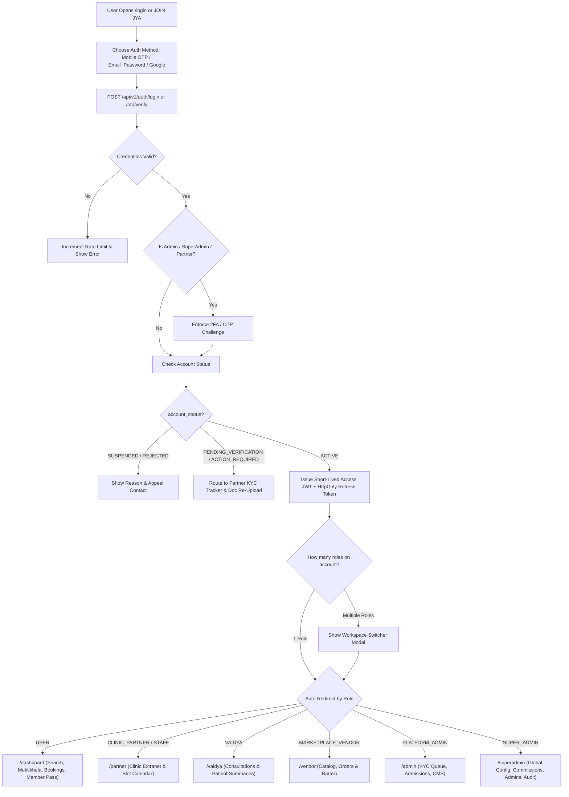
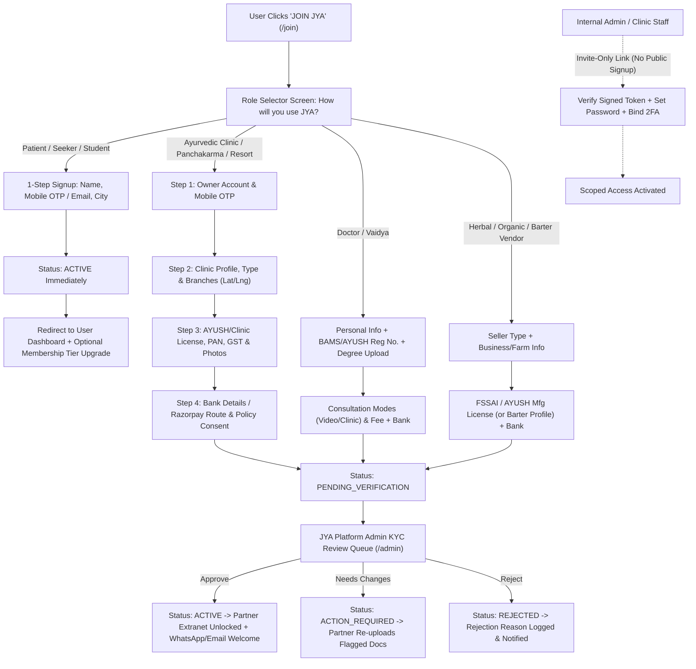
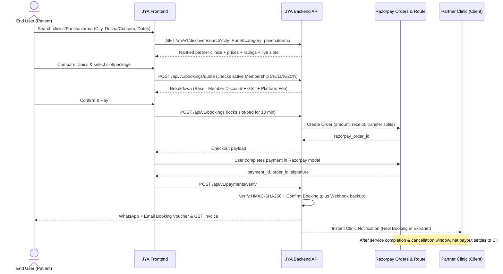

# JnanaYogAyu (JYA) — Complete Website, Role-Based Auth, Flowcharts, UI Blueprint & Backend Architecture

> **Document Scope:** Complete as-built documentation of the `JnanaYogAyu` frontend repository, plus the full **MakeMyTrip-style multi-partner aggregator architecture**, **7-role RBAC & differentiated login/registration flows**, **flowcharts**, **UI screen blueprints**, and **backend API / database / Razorpay specification**.  
> **Note:** No existing frontend (`src/`) or backend files were altered to produce this specification.

---

## 1. Executive Summary & Business Model

### 1.1 MakeMyTrip Model Applied to Ayurvedic Clinics & Holistic Wellness
**JnanaYogAyu (JYA)** operates structurally like **MakeMyTrip**, not by providing travel bookings, but by acting as a **multi-sided digital aggregator and wellness marketplace** connecting multiple independent Ayurvedic & wellness providers ("clients") with end users:

- **Platform Owner (`JYA`):** Operates discovery, search & side-by-side comparison, unified booking & checkout, `Muktikhela` self-assessment recommendations, `JYA Membership` privilege discounts (`5%` / `10%` / `20%`), Razorpay payment verification, and commission/split settlements.
- **Supply Side ("Clients" / Independent Service Providers):**
  1. **Ayurvedic Clinics & OPD Centres** (in-clinic & video consultations)
  2. **Panchakarma & Detox Therapy Centres** (multi-day or single-session therapy packages, rooms/beds)
  3. **Ayurvedic Hospitals & Wellness Retreats** (residential healing stays, SwaGrama stays, seasonal immersions)
  4. **Independent Doctors / Vaidyas** (`Global AyurX` practitioners)
  5. **Gurukul Academies & Mentors** (`Swagurukul`, `जैवमण्डल Ecosphere`)
  6. **Natural Marketplace & Barter Vendors** (herbal formulations, farm-fresh foods, artisan goods, community barter)
- **Demand Side (End Users):** Patients, wellness seekers, learners, and families who discover & compare partner clinics/services, apply membership privileges, book slots/stays/courses, and pay through a single checkout.

---

## 2. Current Frontend Architecture (As-Built Codebase Inventory)

### 2.1 Technology Stack (`package.json`)
| Layer | Installed Packages | Current Usage Status |
| :--- | :--- | :--- |
| **Framework & Build** | `react` (`^19.2.7`), `react-dom`, `vite` (`^8.1.1`) | Active |
| **Routing** | `react-router-dom` (`^7.18.1`) | Active (`BrowserRouter` in `src/App.jsx`) |
| **Styling & UI** | `tailwindcss` (`^3.4.19`), `@mui/material` (`^9.2.0`), `@mui/x-date-pickers`, `react-select`, `lucide-react`, `react-icons` | Active |
| **Motion & Scroll** | `framer-motion` (`^12.42.2`), `lenis` (`^1.3.27`), `react-snowfall` | Active (`LenisContext` in `src/App.jsx`) |
| **Forms & Validation** | `react-hook-form` (`^7.81.0`), `@hookform/resolvers`, `yup` (`^1.7.1`), `zod` (`^4.4.3`) | Active (`yup` schemas in Membership & Shatayush) |
| **API & State** | `axios` (`^1.18.1`), `@tanstack/react-query` (`^5.101.2`), `zustand` (`^5.0.14`) | **Installed, NOT yet wired in `src/`** |
| **Payments** | Razorpay Checkout JS (`https://checkout.razorpay.com/v1/checkout.js`) | Client-side modal only (`src/common/razorpay/razorpay.js`) |

> **Dependency Note:** `src/common/toast/CustomToast.jsx` imports `react-toastify`, which is not currently listed in `package.json`.

### 2.2 Route & Navigation Inventory
| Route Path | Linked From | Current Implementation (`src/App.jsx`) | Status |
| :--- | :--- | :--- | :--- |
| `/` | Navbar (`Home`), Footer | `HomePage` (`src/components/HomePage.jsx`) | **Implemented (Static UI)** |
| `/shatayushWorld` | Navbar (`Shatayush World`) | `ShatayushWorld` (`src/components/shatayushWorld/ShatayushWorld.jsx`) | **Implemented (Local state modals)** |
| `/membership` | Navbar (`Membership`) | `JYAMembershipPage` (`src/components/membership/JYAMembershipPage.jsx`) | **Implemented (Client Razorpay)** |
| `/about`, `/community`, `/services`, `/knowledge`, `/contact` | Footer / Navbar | Inline dummy `<div>` placeholders | **Placeholder Only** |
| `/globalayurx`, `/ecosphere`, `/muktikhela`, `/insight`, `/join` | Navbar (`navLinks` + `JOIN JYA`), Footer (`Join JYA`) | *No `<Route>` defined* | **Missing Route** |
| `/aboutUs`, `/jyaEcosystem`, `/privacyAndPolicy` | Footer (`Explore`) | *No `<Route>` defined* | **Missing Route** |

Navbar also includes **Wishlist** (`FiHeart`) and **Cart** (`FiShoppingCart`) buttons with no state or routes wired yet.

### 2.3 Implemented Features & Gaps Found in Code
1. **`HomePage.jsx`:** Hero, Ecosystem overview, 3 Core Pillars, `MuktikhelaAyurvedaSection` (5-step walkthrough + 4 Health Zones A/B/C/D), `LearnWithGurukul`, `WellnessMarketplace` (`Wellness Services` & `Natural Marketplace`), `SwagramaCommunity`, and static `Blogs` / `Whitepapers` / `Podcasts`.
2. **`ShatayushWorld.jsx` & `shatayusSchema.js`:** Philosophy pillars, 4 Transformation Phases, Seasonal Academies (`Rainy`, `Summer`, `Winter`), 4 membership-gated PDFs, 2-step **21-Day Challenge Modal** (promises WhatsApp survey `"My Conscious Living Baseline"`), and **Enquire Now Modal** — both currently store nothing on a backend.
3. **`JYAMembershipPage.jsx`, `MembershipModal.jsx` & `membershipSchema.js`:**
   - 4 Tiers: `JYA Open` (Free), `शतायुस् World` (`₹500`, 5% discount), `GlobalAyurX` (`₹5,000`, 10% discount), `जैवमण्डल Ecosphere` (Free initial registration, entrance exam, 20% off `₹1,40,000` -> `₹1,12,000`).
   - Known code gaps to resolve during future integration:
     - `razorpay.js` opens checkout without a server-created `order_id` or backend HMAC signature verification (`RAZORPAY_KEY_SECRET` is noted in `.env`).
     - `MembershipModal.jsx` returns `₹1` for free `JYA Open` and `₹500` fallback for `Ecosphere` instead of skipping Razorpay on `₹0` tiers.
     - `Application ID` (`JYA-XXXXXX`) is generated via `Math.random()`.
     - Step 5 `SUBMIT APPLICATION` calls `onSubmit()` directly in `onClick`, bypassing `handleSubmit(onSubmit)` validation on the 4 declarations.
     - Step 2 interest checkboxes (`interest_ayurveda`, etc.) do not match `interests: yup.array()` in `membershipSchema.js`.

---

## 3. Role Architecture & RBAC Matrix (7 Roles)

Because JYA is a **multi-partner healthcare & wellness marketplace** (not a single-user website), **3 basic roles (`SuperAdmin`, `Admin`, `User`) are not enough**. You must separate **internal governance** from **external partner clinics/doctors/vendors** and **end consumers**.

### 3.1 Complete Role Hierarchy (7 Core Roles)

| # | Role Code | Who They Are | How They Register | Verification Gate | Primary Workspace |
| :-: | :--- | :--- | :--- | :--- | :--- |
| 1 | `SUPER_ADMIN` | Platform Founder / Root Owner | **No public signup.** Seeded via CLI/deployment + mandatory 2FA | Pre-verified root identity | `/superadmin` — System settings, commission slabs, create/revoke `PLATFORM_ADMIN`, payout approvals, full audit logs |
| 2 | `PLATFORM_ADMIN` | JYA Internal Ops, Admissions & Compliance Team | **Invite-Only** by `SUPER_ADMIN` (invite link + password + OTP/2FA) | Invite token + 2FA | `/admin` — Approve/reject Clinics/Vaidyas/Vendors, grade Ecosphere entrance exams, manage CMS, disputes & refunds |
| 3 | `CLINIC_PARTNER` | Ayurvedic Clinics, Panchakarma Centres, Hospitals, Wellness Resorts ("MakeMyTrip Suppliers") | **4-Step Public Partner Onboarding** (Owner + Clinic + License + Bank/GST) | **Mandatory KYC & AYUSH/Clinic License Approval** | `/partner` (Clinic Extranet) — Manage branches, doctors, therapies, bed/slot inventory, bookings, earnings & payouts |
| 4 | `CLINIC_STAFF` | Clinic Receptionist, Desk Coordinator, Panchakarma Therapist | **Invite-Only** by their `CLINIC_PARTNER` | Clinic Partner invite token | `/partner` (Scoped Views) — Patient check-in, slot calendar, rescheduling (no bank/payout/commission access) |
| 5 | `VAIDYA` | Ayurvedic Doctor / Practitioner (Independent or Clinic-linked) | **Two Paths:** (A) Independent 3-step self-signup OR (B) Clinic-invited signup | **BAMS / AYUSH Medical Registration Verification** | `/vaidya` — OPD consultation slots (Video/Clinic), patient Muktikhela summaries (with consent), consultation notes |
| 6 | `MARKETPLACE_VENDOR` | Herbal Makers, Organic Farmers, Artisan Sellers, Community Barter Sellers | **3-Step Seller Registration** (Business/Farm + FSSAI/AYUSH Mfg + Pickup/Bank) | **Seller KYC & Compliance Check** | `/vendor` — Product SKUs, stock, order dispatch, barter proposals & settlements |
| 7 | `USER` | Patients, Wellness Seekers, Gurukul Students, Shatayus/GlobalAyurX/Ecosphere Members | **Instant Public Signup** (Mobile OTP / Email + Password / Google OAuth) | Mobile/Email OTP only (Instant Active) | `/dashboard` — Search/compare/book clinics, Muktikhela assessments, family profiles, orders, active Membership Pass & PDFs |

### 3.2 Multi-Role Capability (Important!)
One human email/mobile can hold **more than one role** under a single `user_id` — for example, a registered doctor (`VAIDYA`) can also book a retreat as a patient (`USER`), or own a clinic (`CLINIC_PARTNER`). Upon login, if `roles.length > 1`, the UI presents a **Workspace Switcher** so they do not need separate accounts.

---

## 4. Why Each Registration Flow Is Different (Detailed Breakdown)

```
┌───────────────────────────┬──────────────────────────┬─────────────────────────────────────┐
│        END USERS          │   SUPPLY PARTNERS        │        INTERNAL GOVERNANCE          │
│     (Demand Side)         │  (MakeMyTrip "Clients")  │      (Platform Operations)          │
├───────────────────────────┼──────────────────────────┼─────────────────────────────────────┤
│ • USER (Patient/Learner)  │ • CLINIC_PARTNER         │ • PLATFORM_ADMIN (Ops/Admissions)   │
│                           │ • VAIDYA (Doctor)        │ • SUPER_ADMIN (Root Owner)          │
│                           │ • MARKETPLACE_VENDOR     │ • CLINIC_STAFF (Clinic-scoped)      │
├───────────────────────────┼──────────────────────────┼─────────────────────────────────────┤
│ Frictionless 1-Step       │ Multi-Step KYC Wizard    │ NO Public Registration              │
│ Instant Active Status     │ Pending Admin Review     │ Invite Token / Seeded Only          │
│ No License / Bank Docs    │ License + GST + Bank     │ Mandatory 2FA + Audit Logged        │
└───────────────────────────┴──────────────────────────┴─────────────────────────────────────┘
```

### 4.1 Flow A: End User Registration (`USER`) — Instant Access
- **Purpose:** Zero friction so patients/seekers can immediately book clinics, play Muktikhela, or buy products.
- **Steps:**
  1. Choose method: **Mobile + OTP** (recommended in India), **Email + Password**, or **Continue with Google**.
  2. Enter `Full Name`, `Mobile`, `Email`, `City` (used to localize nearby clinics).
  3. Verify OTP -> Account immediately `ACTIVE`.
  4. *(Optional post-signup prompt)*: "Explore JYA Memberships (`Open`, `Shatayus ₹500`, `Ecosphere`)" or "Add Family Members".

### 4.2 Flow B: Clinic / Wellness Center Partner Registration (`CLINIC_PARTNER`) — 4-Step KYC
- **Purpose:** Prevent fake clinics from accepting patient money; collect payout & tax data upfront.
- **Step 1 — Authorized Owner Account:** Full Name, Role/Designation, Email, Mobile (OTP verified), Password.
- **Step 2 — Organization & Branches:** Clinic/Center Name, Partner Type (`OPD Clinic`, `Panchakarma Centre`, `Ayurvedic Hospital`, `Wellness Resort`, `Gurukul Centre`), Year Established, Address, City/State/Pincode, Map Coordinates (`lat/lng`), Services Offered.
- **Step 3 — Regulatory & Clinical KYC:** Clinical Establishment Reg No. / AYUSH Accreditation, Primary Medical Director Reg No., PAN, GSTIN (optional if under threshold), Upload PDF/Image proofs (Certificate, Clinic Photos).
- **Step 4 — Settlement & Agreement:** Bank Account Holder, Account Number, IFSC, Cancelled Cheque / Razorpay Route onboarding consent, Commission & Cancellation Policy acceptance.
- **Post-Submit State:** `account_status = PENDING_VERIFICATION`. User sees a **Verification Tracker** (cannot publish live paid bookings until `PLATFORM_ADMIN` approves).

### 4.3 Flow C: Doctor / Vaidya Registration (`VAIDYA`) — 2 Sub-Flows
- **Path C1 — Independent Vaidya (Self-Registered):**
  1. Personal & Contact + OTP verification.
  2. Medical Credentials: `BAMS / MD (Ayurveda)` Degree, `CCIM / NCISM / State AYUSH Council Reg No.`, Years of Experience, Specializations (e.g., Panchakarma, Kayachikitsa, Nadi Pariksha), Languages, Upload Degree + Reg Certificate.
  3. Consultation Setup: Modes (`Video` / `Home` / `Clinic`), Base Fee, Bank Account for payouts.
  4. Status -> `PENDING_VERIFICATION` until medical license verified by Admin.
- **Path C2 — Clinic-Invited Vaidya:**
  1. `CLINIC_PARTNER` invites doctor by email/phone.
  2. Doctor accepts invite, sets password, uploads medical Reg No. & degree (skips bank details because payouts settle to the clinic).
  3. Attached to that Clinic tenant after quick credential verification.

### 4.4 Flow D: Marketplace / Barter Vendor Registration (`MARKETPLACE_VENDOR`)
- **Step 1 — Seller Identity:** Seller Category (`Herbal Formulations`, `Natural/Organic Foods`, `Artisan Goods`, `Community Barter Only`).
- **Step 2 — Compliance & Pickup:** Brand/Farm Name, Pickup Address, `AYUSH Manufacturing License` (for medicines) or `FSSAI License` (for foods/oils), Organic Certification (optional badge). *(If Barter-Only: simplified community verification without GST/bank).*
- **Step 3 — Bank & Payout Setup:** PAN, GSTIN, Bank/IFSC for commercial sales -> `PENDING_VERIFICATION`.

### 4.5 Flow E: Internal Admin (`PLATFORM_ADMIN`) & Clinic Staff (`CLINIC_STAFF`) — Invite-Only
- **Why no public signup:** A public "Register as Admin" button is a severe security vulnerability.
- **Flow:**
  1. `SUPER_ADMIN` creates an Admin invite (assigning scoped permissions: e.g., `kyc_approver`, `admissions_officer`, `finance_ops`, `cms_editor`), OR `CLINIC_PARTNER` invites `CLINIC_STAFF` (e.g., `receptionist`, `therapist`).
  2. System emails/WhatsApps a **signed, single-use, 24-hour expiry Invite URL**.
  3. Invitee sets strong password + **binds 2FA (TOTP Authenticator or OTP)** -> account activates strictly within assigned scope.

### 4.6 Flow F: Super Admin (`SUPER_ADMIN`) — Root Bootstrap
- **Zero UI registration.** Provisioned via encrypted server seed script / hardware MFA during initial infrastructure setup. Only `SUPER_ADMIN` can mint or revoke `PLATFORM_ADMIN` privileges, modify global commission rates, or release high-value payout batches.

---

## 5. Unified Login Flow & Status Gate



### 5.1 Role-Based Registration & KYC Approval Flowchart



### 5.2 MakeMyTrip-Style Clinic Search, Booking & Split Settlement Flowchart



---

## 6. UI Screen Blueprints (Login, Registration & Role Portals)

> **Design System Alignment:** All UI screens use JnanaYogAyu's existing palette from `tailwind.config.js` and `src/index.css`: Deep Forest (`#071E14` / `#0F3D2E`), Warm Ivory/Cream (`#FAF5E8` / `#FFFDF9`), Burnished Gold (`#C9A45C` / `#D5A354`), Georgia serif display headings (`font-serif`), and Inter body copy (`font-sans`).

### 6.1 Screen 1 — Unified Login (`/login`)
- **Split-panel card layout:** Left Emerald brand rail (`#0F3D2E`) showcasing JYA values + role security assurance ("One Login for Members, Clinics, Vaidyas & Partners"); Right Ivory form surface (`#FAF5E8`).
- **Auth Tabs:** `Mobile OTP` (default, 10-digit + country code -> 6-digit OTP input + resend timer) | `Email & Password` (Email, Password with show/hide toggle, Forgot Password link) | `Google OAuth` button.
- **Smart Post-Login UX:**
  - If account holds `PLATFORM_ADMIN` or `SUPER_ADMIN` -> transitions inline to **2FA Verification Step** (TOTP / Authenticator code) before issuing session.
  - If account holds multiple roles -> transitions to **Workspace Switcher Modal** (`Continue as Patient`, `Open Clinic Portal`, `Open Vaidya Console`, `Open Admin Panel`).
- **Footer Links:** `"New to JYA? Create an Account -> /join"` + `"Staff or Admin? Use your official invite link"`.

### 6.2 Screen 2 — Role Selection Gateway (`/join` / `/register`)
- **Header:** `"How would you like to join JnanaYogAyu?"`
- **4 Primary Interactive Role Cards (2x2 Grid):**
  1. **Individual / Patient / Learner (`USER`)** — *"Book verified Ayurvedic clinics, play Muktikhela, join Swagurukul & unlock memberships"* -> **Instant Activation Badge**.
  2. **Clinic / Wellness Center (`CLINIC_PARTNER`)** — *"List your OPD clinic, Panchakarma centre, hospital or retreat on JYA (MakeMyTrip-style partner portal)"* -> **4-Step KYC Onboarding**.
  3. **Ayurvedic Doctor / Vaidya (`VAIDYA`)** — *"Offer online & in-clinic consultations, connect with Global AyurX"* -> **Medical License Verification**.
  4. **Herbal / Organic / Barter Vendor (`MARKETPLACE_VENDOR`)** — *"Sell Ayurvedic products, natural foods, artisan goods or join community barter"* -> **Seller Verification**.
- **Security Notice Strip below cards:** *"Internal Operations Admins and Clinic Staff accounts cannot be self-registered. Please accept your email/WhatsApp invitation link."*

### 6.3 Screen 3 — Role-Specific Registration Forms
1. **User Instant Signup UI:** Clean 1-card form (`Full Name`, `Mobile + Verify OTP`, `Email`, `City`, `Terms Checkbox`) -> Instant success -> Optional quick-select card to jump to `Membership Plans` (`/membership`) or `Muktikhela` (`/muktikhela`).
2. **Clinic Partner 4-Step Stepper UI** *(matching existing `MembershipModal.jsx` 2-column dark-emerald stepper rail + cream form body!)*:
   - Left Rail shows steps `1. Owner Account` -> `2. Clinic & Branches` -> `3. Licenses & KYC` -> `4. Bank & Payouts` + live status badge.
   - Right Panel renders step fields, drag-and-drop file upload zone (AYUSH Reg, PAN/GST, Clinic Photos), map pin selector, and final policy consent.
   - **Submitted Screen -> KYC Status Tracker:** Progress bar (`Submitted` -> `Under Admin Review` -> `Verified`), itemized checklist of each document (`Verified` / `Needs Re-upload`), and CTA `"Update Flagged Documents"`.
3. **Vaidya Registration UI:** Toggle at top (`"I practice independently"` vs `"I received a Clinic Invite Code"`), BAMS/MD qualification dropdown, AYUSH Reg No., Specialization multi-select chips, Video vs In-Clinic fee inputs, document upload.
4. **Marketplace Vendor UI:** Radio cards for Seller Type (`Commercial Brand/Store` vs `Community Barter Participant`), conditional FSSAI/AYUSH Manufacturing License field, warehouse/pickup pincode, payout bank fields.

### 6.4 Screen 4 — Role Dashboards (Post-Login Destinations)
- **User Dashboard (`/dashboard`):** Upcoming Clinic Appointments, Active JYA Digital Member Pass (`Open / Shatayus / GlobalAyurX / Ecosphere` with discount badge), Muktikhela Zone History (`Zone A–D` chart), Saved Wishlist Clinics, Cart/Orders, Unlocked PDF Resources.
- **Clinic Partner Extranet (`/partner`):** Today's Appointments & Panchakarma Check-ins, Doctor & Therapy Room Slot Calendar, Service/Package Price Editor, Revenue vs. JYA Commission & Payout Ledger, Staff Invites (`CLINIC_STAFF` & `VAIDYA`).
- **Platform Admin Console (`/admin`):** Partner KYC Approval Queue (side-by-side document viewer + Approve / Request Re-upload / Reject with reason), Ecosphere Entrance Exam & 10-Seat Cohort Manager, Refunds/Disputes, CMS Publisher.
- **Super Admin Console (`/superadmin`):** Platform Admin Invite & Permission Matrix, Global & Custom Partner Commission Slabs (`%`), Razorpay Route Payout Release Authorization, Immutable Security & Financial Audit Logs.

---

## 7. Backend Requirements Specification

### 7.1 Authentication & Security Specs
- **Tokens:** Short-lived JWT Access Token (`15 min`) in memory + `HttpOnly; Secure; SameSite=Lax` Refresh Token (`7–30 days`) stored hashed in `refresh_sessions` table (supports instant session revocation / "Log out all devices").
- **JWT Payload Structure:**
  ```json
  {
    "sub": "usr_91f4...",
    "roles": ["USER", "VAIDYA"],
    "activeRole": "VAIDYA",
    "tenantId": "ptr_clinic_102",
    "verificationStatus": "ACTIVE",
    "membershipTier": "ayurx",
    "discountPercent": 10
  }
  ```
- **Middleware Stack:**
  1. `authenticateJWT` (verifies token & active session)
  2. `requireRole(...allowedRoles)` (enforces RBAC)
  3. `requireVerifiedTenant` (blocks `PENDING_VERIFICATION` clinics/vendors from publishing or receiving live bookings)
  4. `scopeToTenant` (ensures Clinic A can **never** query or modify Clinic B's bookings, patients, or earnings)
  5. `rateLimiter` (brute-force protection on `/auth/login`, `/auth/otp/send`, `/auth/otp/verify`)

### 7.2 Core Database Schema (Logical Data Model)

| Domain | Key Tables | Purpose & Critical Fields |
| :--- | :--- | :--- |
| **Auth & RBAC** | `users`, `user_roles`, `refresh_sessions`, `otp_codes`, `role_invitations`, `audit_logs` | Single identity table (`email`, `phone`, `password_hash`, `is_2fa_enabled`), many-to-many `user_roles` (`role`, `tenant_id`, `status`), hashed OTPs with TTL, signed invite tokens, immutable admin/financial audit trail. |
| **Partners (Clients)** | `partners`, `partner_locations`, `partner_kyc_documents`, `partner_bank_accounts`, `practitioners` | Multi-tenant clinics/centers/vendors (`verification_status`, `commission_rate`, `razorpay_linked_account_id`), geo-indexed branch locations (`lat/lng`), KYC document metadata + review comments, Vaidya profiles & AYUSH reg numbers. |
| **Catalog & Search** | `service_categories`, `services`, `service_packages`, `dosha_tags` | Multi-vertical listings (`OPD`, `PANCHAKARMA`, `NATURE_THERAPY`, `WELLNESS_PROGRAM`, `RETREAT`, `COURSE`), price, duration, mode, membership discount eligibility, cancellation rules. |
| **Inventory & Slots** | `practitioner_schedules`, `slot_overrides`, `facility_inventory`, `inventory_holds` | Weekly schedule templates, holiday overrides, daily residential bed/room capacity, 10-minute checkout locks (`expires_at`). |
| **Bookings & Cart** | `wishlists`, `carts`, `cart_items`, `bookings`, `booking_items` | Multi-service cart & direct bookings, patient details, slot/date snapshot, gross amount, membership discount, GST, platform fee, net total, booking status lifecycle. |
| **Marketplace & Barter** | `products`, `orders`, `order_items`, `barter_listings`, `barter_proposals` | Herbal/natural SKUs, stock, shipping, and community barter exchange offers. |
| **Payments & Ledger** | `payment_orders`, `payment_transactions`, `webhook_events`, `partner_ledger`, `payout_settlements`, `refunds` | Server-generated Razorpay `order_id`, HMAC verification flag, idempotent webhook event log, commission split ledger, settlement UTRs & GST invoices. |
| **Memberships** | `membership_plans`, `membership_applications`, `user_memberships`, `entrance_exams` | 4 plan definitions, 5-step application JSON, official `JYA-XXXXXX` ID, active tier discount %, Ecosphere exam scores & 10-seat batch capacity. |
| **Shatayush & Muktikhela** | `challenge_registrations`, `enquiries`, `muktikhela_sessions`, `muktikhela_answers`, `muktikhela_results` | 21-Day Challenge & Enquiry records, WhatsApp baseline status, bio-profile + BMI, 7-level scoring, Zone (`A–D`) & recommended partner clinics/services. |
| **Content & Trust** | `articles_blogs`, `whitepapers`, `podcasts`, `gated_resources`, `reviews`, `notification_logs` | CMS content, private S3/R2 asset keys, verified post-booking reviews, WhatsApp/Email delivery logs. |

### 7.3 Auth & Role Management REST API Endpoints
- **Unified Auth:**
  - `POST /api/v1/auth/otp/send` (purpose: `login`, `register`, `2fa`, `reset`)
  - `POST /api/v1/auth/otp/verify`
  - `POST /api/v1/auth/login` (returns JWT or `requires2FA: true` challenge token)
  - `POST /api/v1/auth/2fa/verify`
  - `POST /api/v1/auth/oauth/google`
  - `POST /api/v1/auth/refresh`, `POST /api/v1/auth/logout`, `POST /api/v1/auth/password/reset`
  - `POST /api/v1/auth/switch-workspace` (switches `activeRole` / `tenantId` for multi-role accounts)
- **Role-Differentiated Registration:**
  - `POST /api/v1/register/user` (instant active `USER`)
  - `POST /api/v1/register/partner` (creates `CLINIC_PARTNER` + clinic tenant in `PENDING_VERIFICATION`)
  - `POST /api/v1/register/vaidya` (creates `VAIDYA` in `PENDING_VERIFICATION`)
  - `POST /api/v1/register/vendor` (creates `MARKETPLACE_VENDOR` in `PENDING_VERIFICATION`)
  - `POST /api/v1/register/upload-kyc-url` (returns presigned S3/R2 upload URL for license/PAN/GST PDFs)
  - `GET /api/v1/onboarding/status` & `PATCH /api/v1/onboarding/resubmit` (for `PENDING_VERIFICATION` / `ACTION_REQUIRED` partners)
  - `GET /api/v1/invitations/:token` & `POST /api/v1/invitations/:token/accept` (for `PLATFORM_ADMIN`, `CLINIC_STAFF`, and Clinic-linked `VAIDYA`)
- **Admin & Super Admin Governance:**
  - `GET /api/v1/admin/kyc-queue`
  - `PATCH /api/v1/admin/partners/:id/verify` (`APPROVE`, `ACTION_REQUIRED`, `REJECT`, `SUSPEND` + per-document remarks)
  - `POST /api/v1/admin/clinic-staff/invite` (`CLINIC_PARTNER` invites staff/doctors)
  - `POST /api/v1/superadmin/admins/invite` (`SUPER_ADMIN` invites `PLATFORM_ADMIN` with granular permission flags)
  - `PATCH /api/v1/superadmin/commission-rules` & `POST /api/v1/superadmin/payouts/release`

### 7.4 Aggregator Discovery, Booking, Razorpay & Ecosystem APIs
- **Discovery (MakeMyTrip Core):** `GET /api/v1/discover/search` (category, city/lat/lng, mode, dosha, date range, price, rating, sort), `GET /api/v1/clinics/:slug`, `GET /api/v1/clinics/compare?ids=...`, `GET /api/v1/services/:id/availability`.
- **Bookings & Cart:** `GET/POST/DELETE /api/v1/me/wishlist`, `GET/POST/PATCH/DELETE /api/v1/me/cart`, `POST /api/v1/bookings/quote`, `POST /api/v1/bookings`, `POST /api/v1/bookings/:id/cancel`, `GET /api/v1/bookings/:id/invoice`.
- **Razorpay Orders & Webhooks:** `POST /api/v1/payments/create-order` (uses `RAZORPAY_KEY_SECRET`), `POST /api/v1/payments/verify` (HMAC-SHA256 verification), `POST /api/v1/webhooks/razorpay` (idempotent capture/refund/transfer webhook).
- **Memberships, Shatayush & Muktikhela:** `POST /api/v1/memberships/apply` (skips Razorpay on ₹0 tiers), `GET /api/v1/memberships/verify-privilege`, `POST /api/v1/shatayush/challenge` (triggers WhatsApp survey), `POST /api/v1/enquiries`, `GET /api/v1/resources/:id/download` (signed S3 URL), `POST /api/v1/muktikhela/sessions`, `POST /api/v1/muktikhela/sessions/:id/complete` (returns Zone A–D + matched partner clinics).

---

## 8. Supporting Infrastructure & Compliance
- **WhatsApp Business API:** Mandatory for 21-Day Challenge `"My Conscious Living Baseline"` survey delivery, 24-hour membership coordinator outreach, OTP fallback, and clinic booking reminders.
- **Private Object Storage (AWS S3 / Cloudflare R2):** Private buckets with short-lived signed URLs for clinic KYC certificates, doctor medical licenses, patient Muktikhela/consultation attachments, and membership-gated PDFs.
- **Healthcare Data Privacy (DPDP Act Compliant):** Explicit user consent checkbox before sharing `Muktikhela` health profiles or pre-existing conditions with a booked partner clinic/Vaidya; clinic tenant isolation enforced at query level.
- **Concurrency Locks:** Database transactions / Redis locks on time slots and Panchakarma bed inventory during the 10-minute payment window.

---

## 9. Open Decisions Needed Before Implementation
1. **Phase 1 Partner Scope:** Launch with **Ayurvedic Clinics & Panchakarma Centres** first, or also Retreats, Independent Vaidyas, and Herbal/Barter Marketplace together?
2. **Partner Self-Service vs. Admin Managed:** Will clinics get the self-serve Partner Extranet on Day 1, or will JYA Admins create listings manually first?
3. **Booking Mode:** **Instant Confirmation** (live slot/bed calendar) vs. **Request-to-Book** (clinic confirms manually)?
4. **Commission & Membership Discount Split:** Who absorbs the `5% / 10% / 20%` JYA Membership discount when booking a partner clinic — JYA's commission or the clinic's listed price?
5. **Razorpay Split Settlements:** Automated **Razorpay Route** transfers per clinic vs. manual batch bank payouts by JYA Finance?
6. **Advance vs. 100% Upfront Payment:** Support partial advance deposits for multi-day Panchakarma stays or 100% online payment?
7. **Tech Stack Preference:** Preferred backend framework (e.g., Node.js/NestJS/Express + PostgreSQL vs. Python/FastAPI), WhatsApp API provider, and whether an existing Clinic Management/EHR system needs integration.
